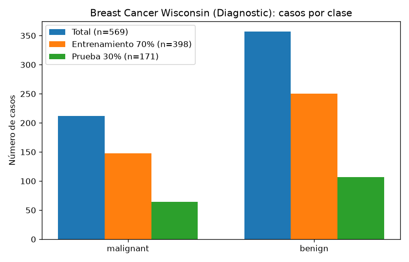
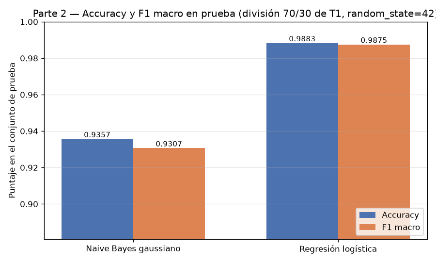
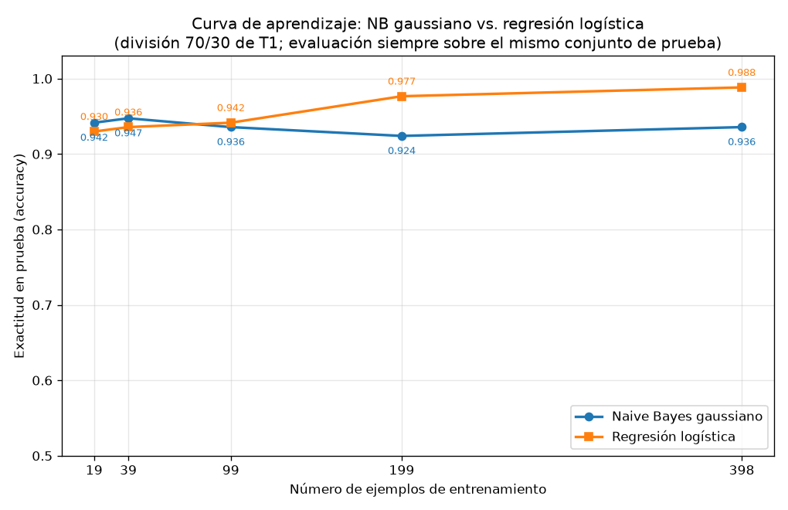

## Introducción

Ng y Jordan (2002) predijeron teóricamente que un clasificador generativo alcanza su error asintótico con menos ejemplos de entrenamiento que un clasificador discriminativo, aunque ese error asintótico sea peor. Esta tarea comprueba esa predicción sobre datos reales usando el conjunto Breast Cancer Wisconsin (Diagnostic): se enfrentan un Naive Bayes gaussiano (generativo) y una regresión logística (discriminativa) en una curva de aprendizaje sobre una única división train/test fija.

## Metodología

**Datos y división.** Se cargó `load_breast_cancer` de scikit-learn: 569 ejemplos, 30 atributos, con 212 casos malignant y 357 benign. Se hizo una división 70/30 estratificada por clase con `random_state=42`, que quedó fija para toda la tarea: 398 ejemplos de entrenamiento (148 malignant, 250 benign) y 171 de prueba (64 malignant, 107 benign). El conjunto de prueba no se usó para ajustar nada.

**Modelos.** Se entrenaron un `GaussianNB` y una `LogisticRegression` (max_iter=5000, random_state=42). Los atributos se estandarizaron con `StandardScaler` ajustado solo con el entrenamiento (en la curva de aprendizaje, solo con cada submuestra), nunca con el conjunto de prueba.

**Curva de aprendizaje.** Sobre la misma división, se entrenaron ambos modelos con submuestras estratificadas del 5 %, 10 %, 25 %, 50 % y 100 % del entrenamiento (`random_state=42`), lo que corresponde a 19, 39, 99, 199 y 398 ejemplos, y se evaluó cada punto siempre sobre el mismo conjunto de prueba. Se reportan accuracy y F1 macro.

## Resultados

**Parte 2 — Modelos con el entrenamiento completo (398 ejemplos).**

| Modelo | Accuracy (prueba) | F1 macro (prueba) |
|---|---|---|
| Naive Bayes gaussiano | 0.9357 | 0.9307 |
| Regresión logística | 0.9883 | 0.9875 |

Con todos los datos, la regresión logística supera al Naive Bayes por 0.0526 de accuracy (0.9883 contra 0.9357).

**Parte 3 — Curva de aprendizaje.** Accuracy sobre el conjunto de prueba (171 ejemplos) para cada tamaño de entrenamiento:

| n_train | Accuracy NB | Accuracy RL | Mejor modelo |
|---|---|---|---|
| 19 | 0.9415 | 0.9298 | Naive Bayes |
| 39 | 0.9474 | 0.9357 | Naive Bayes |
| 99 | 0.9357 | 0.9415 | Regresión logística |
| 199 | 0.9240 | 0.9766 | Regresión logística |
| 398 | 0.9357 | 0.9883 | Regresión logística |

El Naive Bayes gana con 19 ejemplos (diferencia de 0.0117) y con 39 ejemplos (0.0117); la regresión logística gana a partir de 99 ejemplos (0.0058) y la ventaja crece a 0.0526 con 199 y 398 ejemplos.

## Discusión

Los resultados reproducen el cruce que predicen Ng y Jordan. En los tamaños pequeños (19 y 39 ejemplos) el modelo generativo es mejor: alcanza 0.9415 y 0.9474 de accuracy, frente a 0.9298 y 0.9357 de la regresión logística. A partir de 99 ejemplos el orden se invierte y, con el entrenamiento completo, la regresión logística llega a 0.9883 mientras el Naive Bayes se estanca en 0.9357, su valor asintótico ya alcanzado desde la submuestra del 25 % (0.9357 con 99 ejemplos).

La explicación en términos de sesgo y varianza es directa. El Naive Bayes gaussiano impone un supuesto fuerte de independencia condicional entre los 30 atributos, claramente falso en este conjunto (radio, perímetro y área están correlacionados); eso le da un sesgo alto que fija su techo de desempeño cerca de 0.94. A cambio, al estimar solo una media y una varianza por atributo y clase, su varianza es baja: converge muy rápido y ya con 19 ejemplos está cerca de su asíntota (0.9415 contra 0.9357 final). Su curva es casi plana, con una leve caída en 199 ejemplos (0.9240) atribuible a la variabilidad de las submuestras, no a una tendencia de mejora.

La regresión logística tiene menor sesgo porque no impone estructura sobre la distribución conjunta de los atributos, solo asume una frontera lineal; pero estima 30 parámetros de forma discriminativa, lo que implica mayor varianza con pocos datos. Por eso arranca por debajo (0.9298 con 19 ejemplos) y mejora de forma monótona con el tamaño: 0.9357, 0.9415, 0.9766 y 0.9883. Su error asintótico es menor que el del generativo, pero necesita más datos para estabilizar esa estimación. El salto más grande ocurre entre 99 y 199 ejemplos (0.9415 a 0.9766), justo donde la varianza de la estimación se reduce lo suficiente para explotar su menor sesgo.

En síntesis: con 19–39 ejemplos conviene el generativo; con 99 o más conviene el discriminativo, y la brecha a favor del discriminativo crece hasta 0.0526 con el entrenamiento completo. Este es exactamente el patrón teórico: el generativo alcanza antes su asíntota (peor), el discriminativo llega después a una asíntota mejor.

## Conclusiones

Sobre Breast Cancer Wisconsin, con una única división 70/30 estratificada (398/171, random_state=42), se verificó el comportamiento de Ng y Jordan: el Naive Bayes gaussiano gana en regímenes de pocos datos (0.9415 contra 0.9298 con 19 ejemplos) y converge en torno a 0.9357–0.9474, mientras que la regresión logística, más lenta al inicio, lo supera desde 99 ejemplos y alcanza 0.9883 de accuracy y 0.9875 de F1 macro con el entrenamiento completo. La elección práctica depende del presupuesto de datos: con muy pocos ejemplos conviene el modelo generativo de menor varianza; con datos suficientes, el discriminativo de menor sesgo.
