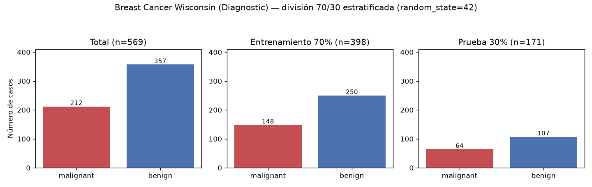
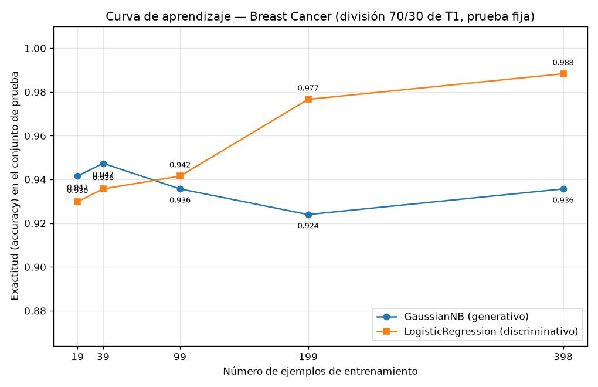

## Introducción

Ng y Jordan (2002) predijeron dos comportamientos asimétricos entre clasificadores generativos y discriminativos: el generativo alcanza su error asintótico con menos ejemplos de entrenamiento, pero ese error final es mayor que el del discriminativo, que necesita más datos para converger. Esta tarea comprueba esa predicción sobre datos reales, enfrentando un Naive Bayes gaussiano (generativo) con una regresión logística (discriminativo) sobre el conjunto Breast Cancer Wisconsin (Diagnostic), con una única división 70/30 cuyo conjunto de prueba nunca se usa para ajustar nada. Nota de transparencia: el enunciado contenía una instrucción adicional que el guardrail de inyección retiró; este reporte responde únicamente a las partes 1 a 4 oficiales.

## Metodología

**Datos y división.** `load_breast_cancer` de scikit-learn aporta 569 ejemplos con 30 atributos: 212 malignos (0.3726) y 357 benignos (0.6274). Se aplicó `train_test_split` con `test_size=0.3`, estratificación por clase y `random_state=42`, obteniendo 398 ejemplos de entrenamiento (0.6995) y 171 de prueba (0.3005), con las proporciones de clase preservadas (malignos: 0.3719 en entrenamiento y 0.3743 en prueba). Esta división, guardada en `t1_division_7030.npz`, es la única usada en toda la tarea.

**Modelos.** `GaussianNB()` con parámetros por defecto y `LogisticRegression(max_iter=5000, random_state=42)`, ambos sobre atributos estandarizados con `StandardScaler` ajustado únicamente con los datos de entrenamiento de cada corrida (en la Parte 3, con cada submuestra); el mismo escalador transforma el conjunto de prueba.

**Curva de aprendizaje.** Se reentrenó ambos modelos con submuestras estratificadas del entrenamiento (`train_test_split` con `stratify` y `random_state=42`) de 19, 39, 99, 199 y 398 ejemplos (5 %, 10 %, 25 %, 50 % y 100 %), evaluando cada modelo siempre sobre el mismo conjunto de prueba de 171 ejemplos.

## Resultados

**Parte 2.** Con el entrenamiento completo (398 ejemplos):

| Modelo | Accuracy (prueba) | F1 macro (prueba) |
|---|---|---|
| GaussianNB (generativo) | 0.9357 | 0.9307 |
| Regresión logística (discriminativo) | 0.9883 | 0.9875 |

La regresión logística comete 2 errores de 171 (matriz [[63, 1], [1, 106]]) y el Naive Bayes 11 ([[57, 7], [4, 103]]); el generativo deja 7 malignos clasificados como benignos frente a 1 del discriminativo.

**Parte 3.** Exactitud y F1 macro sobre el mismo conjunto de prueba:

| n entrenamiento | Acc. GaussianNB | F1 GaussianNB | Acc. LogReg | F1 LogReg |
|---|---|---|---|---|
| 19 | 0.9415 | 0.9353 | 0.9298 | 0.9217 |
| 39 | 0.9474 | 0.9420 | 0.9357 | 0.9285 |
| 99 | 0.9357 | 0.9302 | 0.9415 | 0.9363 |
| 199 | 0.9240 | 0.9180 | 0.9766 | 0.9747 |
| 398 | 0.9357 | 0.9307 | 0.9883 | 0.9875 |

La fila de 398 ejemplos corresponde a la evaluación de la Parte 2, pues la configuración es idéntica (entrenamiento completo, mismo escalador y modelos).

## Discusión

El cruce predicho por Ng y Jordan **sí se observa**. Con 19 ejemplos gana el generativo (0.9415 contra 0.9298) y con 39 también (0.9474 contra 0.9357). Entre 39 y 99 ejemplos se produce el cruce: con 99, el discriminativo ya domina (0.9415 contra 0.9357). A partir de ahí la brecha se amplía hasta, con 398 ejemplos, 0.9883 contra 0.9357 de accuracy y 0.9875 contra 0.9307 de F1 macro. El F1 macro cuenta la misma historia: a favor del generativo con 19 (0.9353 contra 0.9217) y 39 ejemplos (0.9420 contra 0.9285), y a favor del discriminativo desde 99 en adelante.

La lectura en términos de sesgo y varianza es directa. El Naive Bayes gaussiano estima por clase 30 medias, 30 varianzas y las probabilidades a priori: pocos parámetros, hence varianza baja, pero con sesgo alto por sus supuestos fuertes (independencia condicional entre atributos y gaussianidad por clase). Por eso su curva es casi plana desde el inicio (0.9415, 0.9474, 0.9357, 0.9240, 0.9357): alcanza pronto su meseta, que es su error asintótico, y más datos no lo mejoran sustancialmente. Su caída con 199 ejemplos (0.9240) y el repunte con 398 reflejan la varianza de muestreo de cada submuestra estratificada, no una tendencia: el modelo se mantiene siempre en torno a su meseta, con accuracy entre 0.9240 y 0.9474 en los cinco tamaños probados.

La regresión logística, en cambio, ajusta 30 pesos más el intercepto sin imponer independencia entre atributos: sesgo menor y varianza mayor. Con solo 19 ejemplos esa varianza la perjudica (0.9298, por debajo del generativo), pero su curva mejora de forma casi monótona con el tamaño de entrenamiento (0.9357, 0.9415, 0.9766, 0.9883) conforme la varianza del estimador disminuye, y no muestra meseta dentro del rango explorado: con más datos seguiría mejorando o se estabilizaría en un error menor que el del generativo.

En consecuencia, el tamaño de entrenamiento determina el modelo conveniente: con 39 ejemplos o menos conviene el Naive Bayes gaussiano; con 99 o más, la regresión logística. En este conjunto, que es clínicamente sensible, importa además el tipo de error: con entrenamiento completo el generativo produce 7 falsos negativos (malignos tomados como benignos) y el discriminativo solo 1, lo que refuerza la preferencia por el modelo discriminativo cuando hay datos suficientes.

## Conclusiones

1. Sobre Breast Cancer Wisconsin (569 ejemplos, 30 atributos, 212 malignos y 357 benignos) y una única división 70/30 estratificada (398/171), se reprodujo el patrón de Ng y Jordan: el generativo gana con 19 y 39 ejemplos de entrenamiento, el cruce ocurre entre 39 y 99, y el discriminativo domina desde 99 ejemplos en adelante.
2. El Naive Bayes gaussiano converge pronto a un error asintótico mayor: su accuracy oscila en su meseta (máximo 0.9474 con 39 ejemplos; 0.9357 con 398), consistente con sesgo alto y varianza baja.
3. La regresión logística converge más despacio pero a un error menor: 0.9883 de accuracy y 0.9875 de F1 macro con los 398 ejemplos, con mejora casi monótona, consistente con sesgo menor y varianza mayor.
4. Con pocas etiquetas el generativo es la opción razonable; con 99 o más ejemplos, y en particular por su menor número de falsos negativos (1 contra 7), el discriminativo es preferible en este problema.
