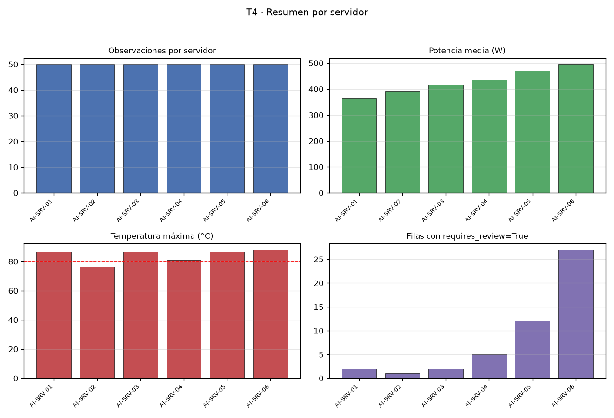

# Procesamiento reproducible de telemetría de servidores de IA

## Tarea 1 - Representar las mediciones

Se leyó `data/server_measurements.csv` con `parse_dates` (timestamp como fecha-hora), sin modificar el CSV de entrada. La clase `ServerMeasurements` almacena `values` (matriz NumPy) y `feature_names` (tupla), y lanza `ValueError` si la matriz no es bidimensional, si el número de columnas no coincide con los nombres o si los datos no son numéricos: las seis validaciones (1D, 3D, columnas de menos, columnas de más, texto y mixto) lanzaron `ValueError` correctamente. `build_measurements(df)` selecciona `gpu_utilization`, `cpu_utilization` y `memory_gb` en ese orden y retorna un objeto con matriz `float64`:

```
ServerMeasurements(shape=(300, 3), features=('gpu_utilization', 'cpu_utilization', 'memory_gb'))
```

Cifras medidas por característica: medias 57.9931, 50.5416 y 29.4553; desviaciones estándar 14.4301, 12.6985 y 6.5368.

## Tarea 2 - Normalizar y calcular un indicador de carga

Medias por columna: `[57.99313333 50.54163333 29.45533333]`; desviaciones (ddof=0): 14.4301, 12.6985 y 6.5368. La normalización Z-score es vectorizada (sin `for` sobre las 300 observaciones) y evita la división por cero si una desviación fuera 0. Resultados: `zscores.shape` (300, 3) y `load_score.shape` (300,), con `load_score = zscores @ [0.50, 0.30, 0.20]`.

Las medias por columna de `zscores` fueron 5.6843e-16, 2.3685e-16 y -3.3159e-16, y las desviaciones 1.0, 1.0 y 1.0: el máximo absoluto de media es 5.6843e-16 y el máximo de |desviación − 1| es 0.0, ambos dentro de la tolerancia 1e-10. El mayor `load_score` medido es 3.1362 (fila 23).

## Tarea 3 - Identificar observaciones para revisión

Se trabajó sobre una copia (el DataFrame original queda intacto): 300 filas y 9 columnas, agregando `load_score` y `requires_review` (dtype bool) con la regla vectorizada `requires_review = (load_score > 1.5) | (temperature_c > 80)`. El `load_score` agregado coincide con el de T2 (diferencia máxima 0.0). Fila 23:

| server | timestamp | load_score | temperature_c | requires_review |
|---|---|---|---|---|
| AI-SRV-01 | 2026-08-24 09:55:00 | 3.1362 | 66.97 | True |

Requieren revisión 49 de las 300 filas: 9 cumplen `load_score > 1.5`, 42 cumplen `temperature_c > 80` y 2 cumplen ambas condiciones. Este DataFrame analizado es el que se persiste en la Tarea 5.

## Tarea 4 - Construir un resumen por servidor

Agrupando por `server` se obtienen 6 filas (una por servidor, en orden alfabético y sin nulos) con exactamente las columnas `server`, `observations`, `mean_power_w`, `max_temperature_c`, `mean_load`, `review_count`:

| server | observations | mean_power_w | max_temperature_c | mean_load | review_count |
|---|---|---|---|---|---|
| AI-SRV-01 | 50 | 363.4598 | 86.5 | -0.614527 | 2 |
| AI-SRV-02 | 50 | 390.499 | 76.47 | -0.41773 | 1 |
| AI-SRV-03 | 50 | 416.6088 | 86.5 | -0.085884 | 2 |
| AI-SRV-04 | 50 | 434.8684 | 80.86 | -0.003041 | 5 |
| AI-SRV-05 | 50 | 471.1808 | 86.5 | 0.453583 | 12 |
| AI-SRV-06 | 50 | 495.7276 | 88.01 | 0.6676 | 27 |

Cada servidor aporta 50 observaciones (300 en total) y la suma de `review_count` es 49, coherente con las 49 filas marcadas en T3. AI-SRV-06 concentra la mayor carga media (0.6676) y 27 revisiones; AI-SRV-01, la menor (-0.614527) con solo 2.



## Tarea 5 - Guardar y verificar el resultado

El DataFrame de T3 se guardó en `output/server_analysis.parquet` con PyArrow (`Table.from_pandas` con `preserve_index=False`, sin índice) y se volvió a leer. Verificaciones del round trip: filas 300 == 300 (True); columnas 9 == 9 (True); esquema idéntico (`server: large_string`, `timestamp: timestamp[us]`, cinco columnas `double`, `requires_review: bool`) (True); valores iguales en las nueve columnas (`DataFrame.equals` True). Salida del código:

```
Round trip verificado: output/server_analysis.parquet
Filas: True
Columnas: True
Esquema: True
Valores: True
```

La fila 23 es idéntica antes y después del round trip (`load_score` 3.1362, `requires_review` True) y se conservan las 49 filas con `requires_review=True`, lo que confirma la integridad del archivo Parquet entregado.
