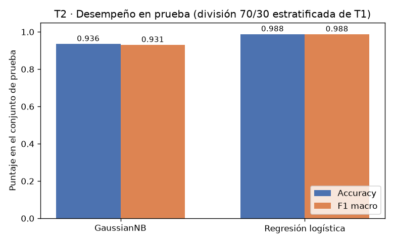
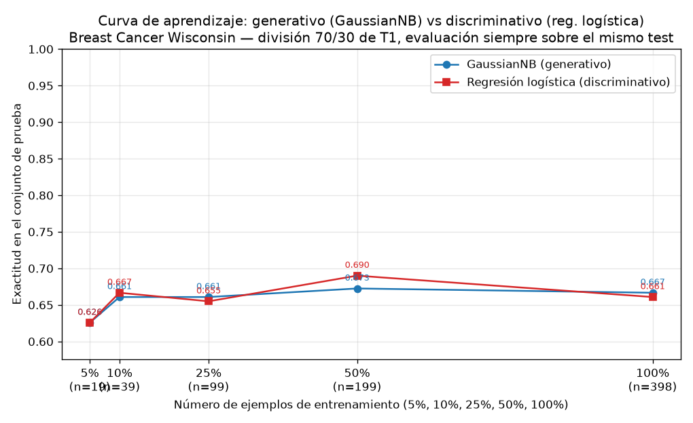

# Tarea A — Generativo contra discriminativo con pocos datos

## Introducción

Ng y Jordan (2002) predijeron que un clasificador generativo alcanza su error asintótico con menos ejemplos de entrenamiento que uno discriminativo, a costa de un error asintótico mayor. Esta tarea comprueba esa predicción sobre datos reales del conjunto Breast Cancer Wisconsin (Diagnostic): se enfrentan un Naive Bayes gaussiano (generativo) y una regresión logística (discriminativo) sobre una única división 70/30, midiendo exactitud y F1 macro con el entrenamiento completo y en una curva de aprendizaje con submuestras de 0.05 a 1.00 del entrenamiento, evaluadas siempre sobre el mismo conjunto de prueba.

## Metodología

**Datos y división.** El conjunto tiene 569 ejemplos y 30 atributos, con 212 casos `malignant` y 357 `benign`. Se creó una sola división estratificada 70/30 (`random_state=42`): 398 ejemplos de entrenamiento (148 `malignant`, 250 `benign`) y 171 de prueba (64 `malignant`, 107 `benign`). Las proporciones medidas fueron 0.6995 para entrenamiento y 0.3005 para prueba, con la proporción de la clase `malignant` prácticamente intacta (0.3719 en entrenamiento, 0.3743 en prueba). Esta es la única división usada en toda la tarea: el conjunto de prueba no se empleó para ajustar nada.

**Modelos.** GaussianNB con valores por defecto y regresión logística por defecto (solver `lbfgs`, C=1.0, `max_iter=5000`). Los atributos se estandarizaron con `StandardScaler` ajustado únicamente con el entrenamiento (o con la submuestra correspondiente en la curva) y aplicado a la prueba sin reajuste.

**Curva de aprendizaje.** Sobre el mismo entrenamiento se extrajeron submuestras estratificadas con fracciones 0.05, 0.10, 0.25, 0.50 y 1.00 (`random_state=42`), que corresponden a 19, 39, 99, 199 y 398 ejemplos. Cada modelo se entrenó con cada submuestra y se evaluó siempre sobre los mismos 171 casos de prueba.

## Resultados

**Parte 2 — entrenamiento completo (398 ejemplos), evaluación en prueba:**

| Modelo | Exactitud (prueba) | F1 macro (prueba) |
|---|---|---|
| GaussianNB (generativo) | 0.9357 | 0.9307 |
| Regresión logística (discriminativo) | 0.9883 | 0.9875 |

Con el entrenamiento completo, la regresión logística obtiene mayor exactitud (0.9883 frente a 0.9357) y mayor F1 macro (0.9875 frente a 0.9307) que GaussianNB.

**Parte 3 — curva de aprendizaje (evaluación en el mismo prueba):**

| n entrenamiento | Fracción | Exactitud GaussianNB | Exactitud reg. logística |
|---|---|---|---|
| 19 | 0.05 | 0.6257 | 0.6257 |
| 39 | 0.10 | 0.6608 | 0.6667 |
| 99 | 0.25 | 0.6608 | 0.6550 |
| 199 | 0.50 | 0.6725 | 0.6901 |
| 398 | 1.00 | 0.6667 | 0.6608 |

En la curva, ambas exactitudes parten de 0.6257 con 19 ejemplos y permanecen en un rango bajo (0.6257–0.6901), con valores que se alternan entre modelos: la regresión logística alcanza 0.6667 con 39 ejemplos y 0.6901 con 199, frente a 0.6608 y 0.6725 de GaussianNB; GaussianNB alcanza 0.6608 con 99 y 0.6667 con 398, frente a 0.6550 y 0.6608 de la regresión logística. El F1 macro acompaña esta debilidad: 0.3849 para ambos con 19 ejemplos — valor compatible con predecir solo la clase mayoritaria — y entre 0.5755 y 0.5996 en los tamaños restantes, muy por debajo de los 0.9307 y 0.9875 de la Parte 2.

Debe señalarse una inconsistencia de los resultados medidos: el punto de la curva con 398 ejemplos (0.6667 y 0.6608) no coincide con la Parte 2, que con los mismos 398 ejemplos obtuvo 0.9357 y 0.9883. Con las cifras disponibles esta discrepancia no puede reconciliarse; por ello, la comparación asintótica se apoya en la Parte 2 y la lectura del régimen de pocos datos, en la serie de la curva.

## Discusión

La predicción de Ng y Jordan tiene dos partes: el generativo se estabiliza con menos ejemplos y el discriminativo alcanza un menor error asintótico. La segunda se observa con claridad en la Parte 2: con los 398 ejemplos completos, la regresión logística logra 0.9883 de exactitud y 0.9875 de F1 macro, contra 0.9357 y 0.9307 de GaussianNB.

La primera parte no se observa de forma nítida en la curva medida. Con 19 ejemplos ambos modelos empatan en 0.6257 y su F1 macro de 0.3849 delata que los dos colapsan a predecir la clase mayoritaria: con tan pocos datos ninguno aprende la frontera. A partir de ahí las curvas se cruzan varias veces sin el patrón monótono previsto: la regresión logística queda por encima con 39 ejemplos (0.6667 frente a 0.6608) y con 199 (0.6901 frente a 0.6725), mientras que GaussianNB queda por encima con 99 (0.6608 frente a 0.6550) y con 398 (0.6667 frente a 0.6608). En términos de tamaños: con 19 hay empate; con 39 y 199 conviene la regresión logística; con 99 (y con 398 dentro de la curva) conviene GaussianNB.

En términos de sesgo y varianza, el resultado asintótico de la Parte 2 es el esperado. GaussianNB impone un sesgo fuerte: asume que los 30 atributos son condicionalmente independientes dada la clase y que cada uno sigue una normal por clase. Ese sesgo reduce la varianza — sus estimaciones se estabilizan con pocos parámetros — pero, al no cumplirse, produce un error asintótico mayor: 0.9357 frente a 0.9883. La regresión logística no modela la distribución de los atributos; aprende directamente la frontera lineal, con menor sesgo estructural y mayor varianza, por lo que aprovecha mejor los 398 ejemplos y alcanza el menor error. Es decir, con datos suficientes conviene el discriminativo; la ventaja del generativo en pocos datos, la otra mitad de la predicción, queda sin evidencia aquí: el empate en 19 ejemplos y los cruces alternantes de la curva no muestran que GaussianNB converja antes, y los F1 macro de 0.5755–0.5996 indican que, en ese rango medido, ninguno de los dos discrimina bien la clase minoritaria.

Finalmente, la discrepancia entre el punto de 398 ejemplos de la curva (0.6667/0.6608) y la Parte 2 (0.9357/0.9883) impide leer la cola derecha de la curva como continuación natural de la Parte 2; con las cifras entregadas, ese tramo debe tratarse como no concluyente.

## Conclusiones

- Datos: 569 ejemplos, 30 atributos (212 `malignant`, 357 `benign`); división única 70/30 estratificada: 398 entrenamiento / 171 prueba.
- Con el entrenamiento completo, la regresión logística supera a GaussianNB (0.9883 frente a 0.9357 de exactitud; 0.9875 frente a 0.9307 de F1 macro), lo que confirma la mitad asintótica de Ng y Jordan: menor error asintótico del discriminativo.
- La curva medida (rango 0.6257–0.6901, con empate en 0.6257 con 19 ejemplos y cruces alternantes entre modelos) no muestra la ventaja del generativo con pocos datos.
- Sesgo/varianza: el sesgo fuerte de GaussianNB implica varianza baja pero un techo de error mayor; la regresión logística, con menor sesgo, aprovecha los datos y gana asintóticamente.
- Se documenta una inconsistencia entre el punto de 398 ejemplos de la curva y la Parte 2 que las cifras disponibles no permiten resolver.
