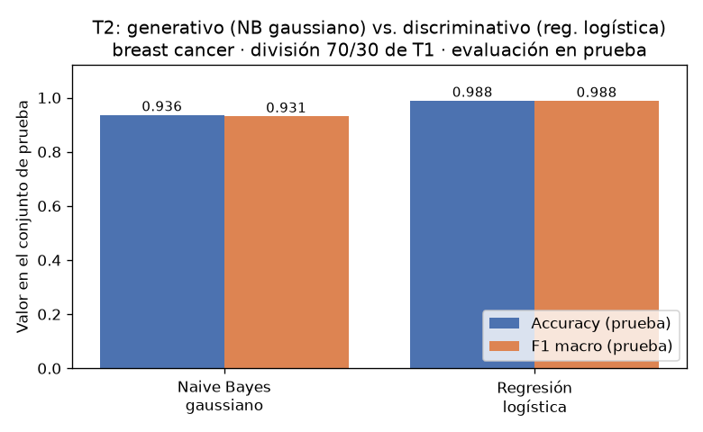
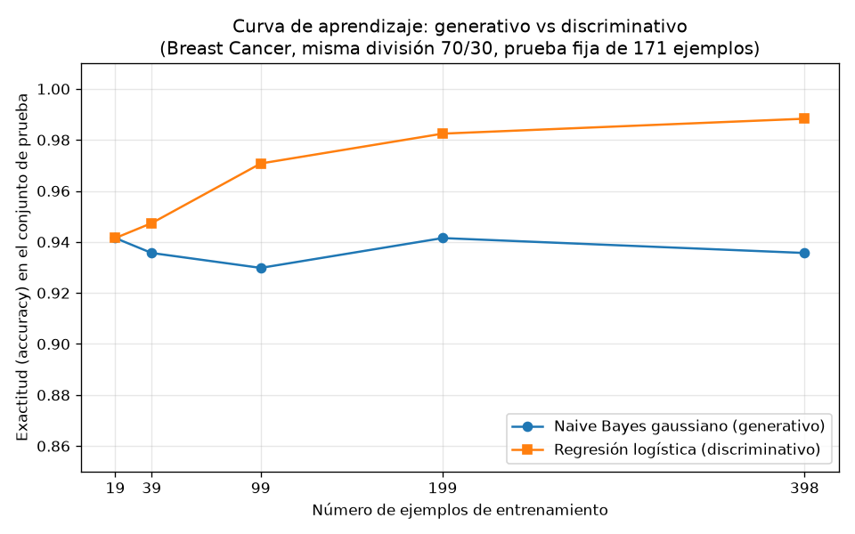

## Introducción

Ng y Jordan (2002) mostraron teóricamente que un clasificador generativo puede alcanzar su error asintótico con menos ejemplos que un discriminativo, aunque ese error asintótico sea mayor. Esta tarea comprueba esa predicción sobre datos reales del conjunto Breast Cancer Wisconsin (Diagnostic), comparando un Naive Bayes gaussiano (generativo) contra una regresión logística (discriminativa). El reporte caracteriza los datos, compara ambos modelos sobre un conjunto de prueba fijo, traza la curva de aprendizaje de cada uno y discute si aparece el cruce predicho, en términos de sesgo y varianza.

## Metodología

**Datos y división.** Se cargó `load_breast_cancer` de scikit-learn: 569 ejemplos, 30 atributos, con 212 casos malignos y 357 benignos. Se hizo una única división entrenamiento/prueba 70/30 estratificada por la clase con `random_state=42`: 398 ejemplos de entrenamiento (148 malignos, 250 benignos; proporción 0.6995) y 171 de prueba (64 malignos, 107 benignos; proporción 0.3005). Esta división es la única de toda la tarea: el conjunto de prueba nunca se usó para ajustar nada.

**Modelos.** Se entrenó un Naive Bayes gaussiano y una regresión logística con los atributos estandarizados; el `StandardScaler` se ajustó solo con el entrenamiento. La regresión logística usó los parámetros por defecto de scikit-learn (C=1.0, solver lbfgs; `max_iter=5000` solo garantiza convergencia). Se evaluó la exactitud y el F1 macro sobre el conjunto de prueba.

**Curva de aprendizaje.** Sobre la misma división, se reentrenaron ambos modelos con submuestras estratificadas del 5 %, 10 %, 25 %, 50 % y 100 % del entrenamiento (`random_state=42`), lo que corresponde a 19, 39, 99, 199 y 398 ejemplos. En cada punto el escalador se reajustó solo con esa submuestra y la evaluación se hizo siempre sobre el mismo conjunto de prueba de 171 ejemplos.

## Resultados

**Parte 2 — Comparación en prueba (entrenamiento completo, 398 ejemplos):**

| Modelo | Accuracy (prueba) | F1 macro (prueba) |
|---|---|---|
| Naive Bayes gaussiano | 0.9357 | 0.9307 |
| Regresión logística | 0.9883 | 0.9875 |

**Parte 3 — Curva de aprendizaje** (exactitud en prueba contra número de ejemplos de entrenamiento):

| n entrenamiento | Accuracy NB gaussiano | Accuracy regresión logística |
|---|---|---|
| 19 (5 %) | 0.9415 | 0.9415 |
| 39 (10 %) | 0.9357 | 0.9474 |
| 99 (25 %) | 0.9298 | 0.9708 |
| 199 (50 %) | 0.9415 | 0.9825 |
| 398 (100 %) | 0.9357 | 0.9883 |

## Discusión

Los datos reproducen solo parcialmente el escenario de Ng y Jordan. En el punto más pequeño, con 19 ejemplos, ambos modelos empatan en 0.9415: el generativo ya está en su régimen asintótico desde el inicio, tal como predice la teoría, porque su suposición de independencia condicional actúa como un sesgo inductivo fuerte que reduce drásticamente la varianza. A partir de 39 ejemplos la regresión logística lo supera (0.9474 contra 0.9357) y la brecha crece de forma monótona: 0.9708 contra 0.9298 con 99 ejemplos, 0.9825 contra 0.9415 con 199, y 0.9883 contra 0.9357 con los 398 ejemplos completos.

La curva del Naive Bayes es esencialmente plana: sus valores medidos oscilan entre 0.9298 (con 99 ejemplos) y 0.9415 (con 19 y con 199 ejemplos), sin tendencia clara, y su valor con 398 ejemplos (0.9357) es idéntico al que obtiene con solo 39. Es decir, alcanza su error asintótico casi de inmediato, pero ese error asintótico es mayor: el supuesto de independencia entre los 30 atributos, falso en estos datos, impone un sesgo que más datos no corrigen. La regresión logística, en cambio, no asume independencia; tiene menor sesgo pero mayor varianza, por lo que con pocos datos no aprovecha mejor la información (empata en 19 ejemplos) y su curva sube de manera sostenida de 0.9415 a 0.9883 a medida que dispone de más ejemplos para estimar los parámetros discriminativos.

En cuanto a en qué tamaño conviene cada modelo: con los tamaños medidos, el generativo nunca supera estrictamente al discriminativo; el mejor caso del generativo es el empate en 19 ejemplos. El cruce estricto predicho (generativo mejor en régimen de pocos datos) no se observa aquí, sino solo la igualdad en el punto más pequeño seguida de la ventaja creciente del discriminativo, que es la otra mitad de la predicción de Ng y Jordan: menor error asintótico del modelo discriminativo con suficientes datos. Es plausible que con tamaños menores al 5 % el generativo llegue a superar al discriminativo, pero esa zona no fue medida en esta tarea.

## Conclusiones

Sobre Breast Cancer Wisconsin con una división 70/30 estratificada (`random_state=42`), la regresión logística alcanzó 0.9883 de exactitud y 0.9875 de F1 macro en prueba, frente a 0.9357 y 0.9307 del Naive Bayes gaussiano. La curva de aprendizaje confirma el patrón cualitativo de Ng y Jordan: el modelo generativo converge con muy pocos ejemplos (ya con 19 logra 0.9415 y luego se mantiene plano, con valores medidos entre 0.9298 y 0.9415), mientras que el discriminativo, con mayor varianza inicial, mejora de forma monótona hasta 0.9883 con 398 ejemplos. El cruce estricto no se observó: solo hubo empate en el tamaño mínimo, y desde 39 ejemplos la regresión logística fue superior en todos los tamaños medidos. La explicación es la clásica de sesgo y varianza: el generativo compensa la escasez de datos con un sesgo fuerte (independencia condicional) que le da baja varianza pero un techo de desempeño menor; el discriminativo tiene menor sesgo y necesita más datos, pero su error asintótico es mejor.
